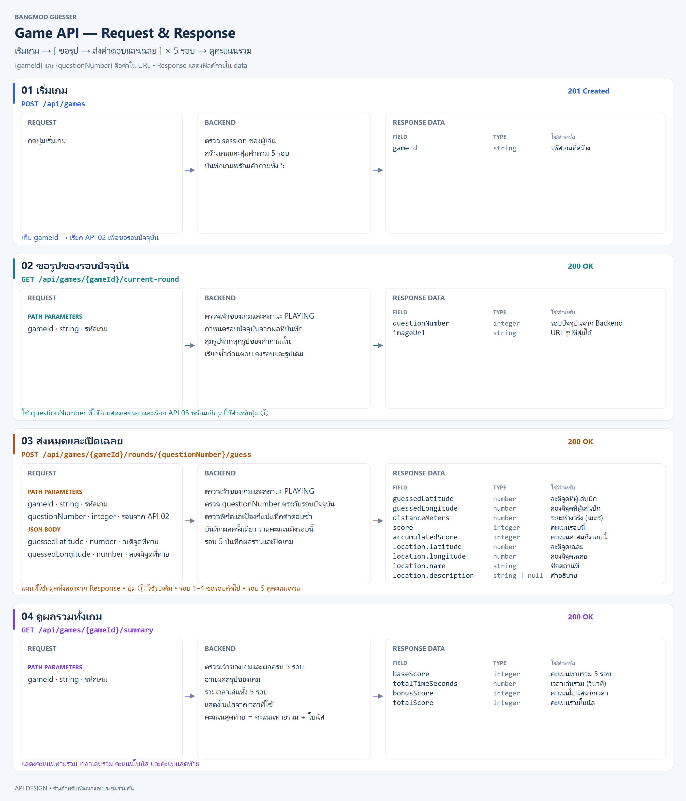

# สรุป Game API

สัญญา Backend สำหรับระบบทายสถานที่ 5 รอบ (BE-008)



## ลำดับการเล่น

ผู้เล่นกดเริ่มเกม → API 01 สร้างเกม → วน API 02 ขอรูป และ API 03 ส่งคำตอบพร้อมเฉลย ครบ 5 รอบ → API 04 ดูคะแนนรวม

| API | Method | Endpoint |
| --- | --- | --- |
| 01 เริ่มเกม | POST | `/api/games` |
| 02 ขอรูปของรอบปัจจุบัน | GET | `/api/games/{gameId}/current-round` |
| 03 ส่งคำตอบและเฉลย | POST | `/api/games/{gameId}/rounds/{questionNumber}/guess` |
| 04 สรุปคะแนน | GET | `/api/games/{gameId}/summary` |

`gameId` คือรหัสเกมที่ได้จาก API 01 ส่วน `questionNumber` คือเลขรอบ 1–5 Frontend แทนค่าลงใน URL เช่น `POST /api/games/g7/rounds/2/guess` และส่งพิกัดที่ทายใน JSON body

## 01 เริ่มเกม

**POST `/api/games`**

Frontend เรียกเมื่อกดเริ่มเกม Backend ตรวจ session สุ่มสถานที่ ACTIVE ที่มีรูปจำนวน 5 แห่งไม่ซ้ำ และสุ่ม imageNumber ของแต่ละแห่งตั้งแต่ตอนนี้ สร้าง Game พร้อม GameRound ทั้ง 5 รอบด้วย nested write ภายใน transaction หากข้อมูลไม่พอหรือเปลี่ยนระหว่างสร้าง ตอบ 409 โดยไม่ทิ้งเกมบางส่วน

ตอบกลับ HTTP 201 โดยข้อมูลภายใน `data` มีดังนี้

```json
{
  "gameId": "g7"
}
```

| ฟิลด์ | ชนิด | การใช้งาน |
| --- | --- | --- |
| gameId | string | Frontend เก็บไว้เรียก API ของเกมนี้ แล้วขอรอบปัจจุบันจาก API 02 |

## 02 ขอรูปของคำถาม

**GET `/api/games/{gameId}/current-round`**

| Path parameter | ชนิด | ความหมาย |
| --- | --- | --- |
| gameId | string | รหัสเกม |

Backend ตรวจเจ้าของเกมและสถานะ PLAYING แล้วกำหนดรอบปัจจุบันจากรอบแรกที่ยังไม่บันทึกผล อ่านรูปผ่าน locationId + imageNumber ที่บันทึกตั้งแต่เริ่มเกม โดยไม่สุ่มใหม่ ส่งกลับเลขรอบและ URL ของรูปที่สุ่มได้ การเรียกซ้ำขณะยังไม่ส่งคำตอบคงรอบและรูปเดิม เมื่อรับคำตอบรอบนั้นสำเร็จจึงเปลี่ยนเป็นรอบถัดไป เกมที่จบแล้วให้ตอบข้อผิดพลาดแทนการเปิดคำถามใหม่

ตอบกลับ HTTP 200 โดยข้อมูลภายใน `data` มีดังนี้

```json
{
  "questionNumber": 2,
  "imageUrl": "https://images.example.invalid/question-image.webp"
}
```

| ฟิลด์ | ชนิด | การใช้งาน |
| --- | --- | --- |
| imageUrl | string | แสดงรูปของคำถาม และเก็บไว้ใช้กับปุ่ม ⓘ หลังเฉลย |
| questionNumber | integer | รอบปัจจุบันที่ Backend กำหนด Frontend ใช้แสดงเลขรอบและส่งกลับใน path ของ API 03 |

บันทึก startedAt ครั้งแรกของแต่ละรอบเท่านั้น การรีเฟรชไม่เริ่มเวลาใหม่และไม่รวมเวลาพักหน้าเฉลย

Response เส้นนี้มีเลขรอบและ URL รูป โดยคัดกรองพิกัดจริง ชื่อสถานที่ และข้อมูลเฉลยออกก่อนส่ง

## 03 ส่งคำตอบและเฉลย

**POST `/api/games/{gameId}/rounds/{questionNumber}/guess`**

ใช้เส้นเดียวกันสำหรับรอบ 1–5

| Path parameter | ชนิด | ความหมาย |
| --- | --- | --- |
| gameId | string | รหัสเกม |
| questionNumber | integer | เลขรอบที่ตอบ |

Frontend ส่ง JSON body พร้อม `Content-Type: application/json`

```json
{
  "guessedLatitude": 13.65,
  "guessedLongitude": 100.49
}
```

| Body field | ชนิด | ความหมาย |
| --- | --- | --- |
| guessedLatitude | number | ละติจูดที่ผู้เล่นทาย |
| guessedLongitude | number | ลองจิจูดที่ผู้เล่นทาย |

Backend ตรวจเจ้าของเกม ตรวจว่าเกมยังมีสถานะ PLAYING และ questionNumber ตรงกับรอบปัจจุบันที่เปิดให้เล่น รวมถึงตรวจพิกัดและรอบที่ยังไม่บันทึกคำตอบ จากนั้นคำนวณระยะห่างกับคะแนน บันทึกคำตอบ คะแนน และเวลาเล่น แล้วรวมคะแนนตั้งแต่รอบ 1 ถึงรอบปัจจุบัน เมื่อจบรอบ 5 บันทึกผลรวมและปิดเกม

ตรวจสถานะและบันทึกผลใน transaction พร้อม conditional write หรือ lock เพื่อให้คำขอพร้อมกันบันทึกผลได้เพียงครั้งเดียว คำตอบซ้ำ รอบไม่ตรง และเกมที่จบแล้ว ตอบ HTTP 409 โดยไม่เปลี่ยนผลหรือเพิ่มคะแนน คืนเฉลยหลังบันทึกสำเร็จเท่านั้น

ตอบกลับ HTTP 200 ตัวอย่างข้อมูลภายใน `data` ของรอบ 2 เมื่อรอบแรกได้ 800 คะแนน ตัวเลขใช้ประกอบรูปแบบ

```json
{
  "guessedLatitude": 13.65,
  "guessedLongitude": 100.49,
  "distanceMeters": 15.5,
  "score": 881,
  "accumulatedScore": 1681,
  "imageUrl": "https://images.example.invalid/question-image.webp",
  "location": {
    "latitude": 13.6501,
    "longitude": 100.4901,
    "name": "สถานที่ตัวอย่าง",
    "description": "คำอธิบายสถานที่"
  }
}
```

| ฟิลด์ | ชนิด | การใช้งาน |
| --- | --- | --- |
| distanceMeters | number | ระยะจากหมุดที่ทายถึงจุดจริง หน่วยเมตร |
| guessedLatitude | number | ละติจูดที่ผู้เล่นปักและ Backend บันทึก ใช้วาดหมุดที่ทาย |
| guessedLongitude | number | ลองจิจูดที่ผู้เล่นปักและ Backend บันทึก ใช้วาดหมุดที่ทาย |
| score | integer | คะแนนของรอบนี้ |
| accumulatedScore | integer | คะแนนสะสมรอบ 1 ถึงรอบปัจจุบัน |
| imageUrl | string | รูปเดิมของรอบนี้สำหรับหน้าเฉลย |
| location.latitude | number | ละติจูดเฉลย |
| location.longitude | number | ลองจิจูดเฉลย |
| location.name | string | ชื่อสถานที่ |
| location.description | string หรือ null | คำอธิบายสถานที่ |

หน้าเฉลยแสดงระยะจริง คะแนนรอบนี้ และคะแนนสะสม แผนที่ใช้ guessedLatitude กับ guessedLongitude จาก Response วาดหมุดผู้เล่น คู่กับ location.latitude และ location.longitude ที่เป็นหมุดเฉลย ปุ่ม ⓘ เปิดชื่อ คำอธิบาย และimageUrl จาก API 03 ของรอบนี้ได้ทันที

- เฉลยรอบ 1–4 แสดงปุ่ม **รอบถัดไป** แล้วเรียก API 02 ให้ Backend กำหนดรอบถัดไป
- เฉลยรอบ 5 แสดงปุ่ม **ดูคะแนนรวม** แล้วเรียก API 04

## 04 สรุปคะแนน

**GET `/api/games/{gameId}/summary`**

| Path parameter | ชนิด | ความหมาย |
| --- | --- | --- |
| gameId | string | รหัสเกมที่เล่นจบแล้ว |

Backend ตรวจเจ้าของเกม สถานะ COMPLETED และผลครบ 5 รอบ รวมเวลาเล่นและคะแนนทาย แล้วคืน totalScore ที่บันทึกตอนจบเกม พร้อม bonusScore = totalScore - baseScore เพื่อให้ตรงกับประวัติและ leaderboard แม้ปรับสูตรโบนัสในภายหลัง

ตอบกลับ HTTP 200 ตัวอย่างข้อมูลภายใน `data`

```json
{
  "baseScore": 4000,
  "totalTimeSeconds": 120,
  "bonusScore": 126,
  "totalScore": 4126
}
```

ตัวเลขใช้ประกอบรูปแบบ ส่วนสูตรคะแนนและโบนัสให้ใช้กติกาที่ทีมกำหนด

| ฟิลด์ | ชนิด | การใช้งาน |
| --- | --- | --- |
| baseScore | integer | คะแนนทายรวมทั้ง 5 รอบ |
| totalTimeSeconds | number | เวลาเล่นรวม หน่วยวินาที |
| bonusScore | integer | คะแนนโบนัสจากเวลาที่ใช้ |
| totalScore | integer | คะแนนสุดท้ายรวมโบนัส |

## รูปแบบการรับส่งร่วมกัน

ระบบใช้ session cookie ระบุตัวผู้เล่น เมื่อล็อกอินสำเร็จ Backend ส่ง `Set-Cookie` เบราว์เซอร์เก็บแล้วแนบ `Cookie` เมื่อเรียก API ตามเงื่อนไขของ cookie ส่วน Backend ตรวจ session เพื่ออ่าน `user.id` และตรวจเจ้าของเกม

JSON response ใช้รูปแบบกลางของโปรเจกต์ ตัวอย่างข้างต้นแสดงเฉพาะข้อมูลภายใน `data` รูปแบบเต็มเมื่อเริ่มเกมสำเร็จคือ

```json
{
  "data": {
    "gameId": "g7"
  },
  "status": 201,
  "statusCode": "CREATED"
}
```

คำขอสำเร็จของ API 02–04 ใช้ `status: 200` และ `statusCode: "SUCCESS"` ส่วนข้อผิดพลาดใช้รูปแบบกลาง `{ error, status, statusCode: "ERROR" }`

## กติกาคะแนนและความเข้ากันได้ (BE-008)

- ใช้ Haversine เดิมจาก `src/shared/lib/calculate-distance.ts` หน่วยเมตร ใช้ค่าจริงคำนวณคะแนน และปัดระยะแสดงผลสองตำแหน่ง
- คะแนนระยะทาง: `S(d) = round(1000 × exp(ln(0.7) × (max(0, d) / 25)^p))` โดย `p = ln(ln(0.2) / ln(0.7)) / ln(2) ≈ 2.1738751462` สูตรนี้ได้จากจุดอ้างอิงในภาพและตรงกับตารางทุกแถว
- ระยะ 0 / 5 / 10 / 15 / 20 / 25 / 30 / 35 / 40 / 45 / 50 / 60 / 75 / 100 / 150 เมตร ให้ 1000 / 989 / 953 / 889 / 803 / 700 / 589 / 477 / 371 / 278 / 200 / 91 / 21 / 1 / 0 คะแนน ตามลำดับ
- โบนัสเวลา: `B(t) = round(300 × max(0, min(1, (200 - t) / 190)))` โดย t เป็นเวลาเล่นจริงรวม 5 รอบ (วินาที)
- เวลาไม่เกิน 10 วินาที ได้ 300 คะแนน; 20 / 30 / 60 / 100 / 150 / 180 / 190 / 200 วินาที ได้ 284 / 268 / 221 / 158 / 79 / 32 / 16 / 0 คะแนน
- คิดโบนัสครั้งเดียวตอนจบเกม คะแนนทายเต็ม 5000 + โบนัสเต็ม 300 = คะแนนรวมสูงสุด 5300; เช่นเวลา 120 วินาทีได้โบนัส 126
- ฟังก์ชันคำนวณอยู่ใน `src/features/game/lib/game-scoring.ts` และค่าคงที่อยู่ใน `src/features/game/game.constants.ts`
- ต้องเปิดรอบผ่าน current-round ก่อนส่ง guess จับเวลาจาก startedAt ของรอบนั้นและปัดลงเป็นวินาที ไม่รวมช่วงพักหน้าเฉลย
- ตอนสร้างเกม ล็อกสถานที่ด้วย query เดียวเรียงตาม id และตรวจรูปทั้งชุดด้วย query เดียวก่อน nested write
- ปฏิเสธผลรอบก่อนหน้าที่ขาดเวลา/พิกัด แทนการเล่นต่อและสร้าง summary ที่ใช้ไม่ได้
- ล็อกแถว Game ก่อนเปลี่ยนรอบ แล้ว conditional update ด้วย gameId + questionNumber + PENDING ภายใน transaction เดียวกันกับผลรวมรอบสุดท้าย ป้องกัน guess ซ้ำและการแข่งขันกับ exit
- schema คง imageNumber nullable ตามระบบจัดการรูปเดิม (ล้าง relation ของประวัติเกมเมื่อแอดมินลบรูป) แต่ Game API สร้างรอบใหม่พร้อม imageNumber เสมอ เกมเก่าที่ไม่มีรูปประจำรอบตอบ 409 ต้องเริ่มเกมใหม่
- ภาพ game-api.png เป็นแผนภาพเดิมก่อน BE-008: ข้อความการสุ่มใน API 02 และฟิลด์ API 03 ให้ยึดสัญญา Markdown นี้

## ตรวจสอบและนำไปใช้

- ใช้ migration `20261110000000_add_round_started_at` ผ่านขั้นตอน deploy ของทีม แล้วรัน `npx prisma generate`
- ทุก endpoint ต้องมี session: 401 เมื่อไม่ล็อกอิน, 403 เมื่อไม่ใช่เจ้าของ, 404 เมื่อไม่พบเกม, 400 เมื่อ input ไม่ถูกต้อง และ 409 เมื่อสถานะหรือรอบไม่ตรง
- Unit: `npx vitest run tests/unit/core/service/game tests/unit/core/domain/game-scoring.test.ts tests/unit/core/schema/game-guess.schema.test.ts`
- Route integration ใช้ service/factory จริงและ mock เฉพาะ auth/repository: `npx vitest run tests/integration/api/game-`
- PostgreSQL integration (ฐานข้อมูลทดสอบเฉพาะ port 5439 ที่ migrate แล้ว): ตั้ง `RUN_GAME_DATABASE_TESTS=1` แล้วรัน `npx vitest run tests/integration/repositories/game-play.repository.integration.test.ts`
- HTTP E2E พร้อม session จริงและฐานข้อมูลแยก: `npm run test:e2e -- game-api.spec.ts` ต้องมี Docker และ Playwright browser
- งานนี้ครอบคลุม Backend เท่านั้น หน้าเล่นเกมเดิมยังใช้ข้อมูล mock และยังไม่ได้เชื่อมต่อ API ใหม่

### ผลตรวจในเครื่องสำหรับ BE-008

รอบตรวจทานก่อนเปลี่ยนสูตรเพิ่ม regression tests สำหรับคะแนน summary ที่ต่างจากคะแนนบันทึก และผลรอบก่อนหน้าที่ขาดเวลา/พิกัด โดยยืนยันว่าเทสต์ล้มเหลวก่อนแก้และผ่านหลังแก้

- ใช้ของเดิม: `requireAuth`, `AppError`, `readJson`, `parseSchema`, `successResponse`, `errorResponse`, Prisma singleton/container, `haversineDistanceMeters` และ mock repository สำหรับเทสต์
- ลบสูตรระยะทางที่ซ้ำ ลดการเรียกฐานข้อมูลในส่วนล็อก/ตรวจรูปจาก 10 เป็น 2 ครั้ง และคำนวณโบนัสเฉพาะเมื่อจบรอบสุดท้าย
- รอบตรวจทานนี้ไม่เพิ่มไฟล์ dependency ตาราง หรือ service ใหม่; คอลัมน์ startedAt จากงานเดิมยังจำเป็นต่อการจับเวลาจริง
- ตรวจ syntax tree ของ TypeScript/TSX ทุกไฟล์ที่ BE-008 เปลี่ยน ไม่พบคอมเมนต์; migration ใหม่ไม่มีคอมเมนต์
- migration ถูกสร้างไว้ใน repository แต่ยังไม่ได้ apply กับฐานข้อมูลใด และไม่ได้ deploy หรือ push

ผลรันล่าสุดหลังแก้:

| คำสั่ง | ผล |
| --- | --- |
| `npm run test:unit` | 407 ผ่านหลังเปลี่ยนสูตร |
| `npm run test:component` | 244 ผ่าน |
| `npm run test:integration` | 102 ผ่าน / 22 skipped (PostgreSQL opt-in) |
| `npm run lint` | ผ่าน |
| `npm run typecheck` | ผ่าน |
| `npx prisma validate` | ผ่าน |
| `npm run build` | ผ่าน รวม Prisma generate และ Next.js production build |
| `git diff --check` | ผ่าน |
| `npm run test:e2e -- game-api.spec.ts` | เริ่มไม่ได้: `spawnSync docker ENOENT` ก่อนเริ่มเทสต์ |

ปัญหา Prisma DLL ถูกล็อกจากรอบก่อนหน้าไม่เกิดในการรัน build รอบตรวจทานนี้ ส่วน build ยังแจ้งเตือน BETTER_AUTH_SECRET ใน environment ปัจจุบันสั้น/entropy ต่ำ ไม่ได้เปลี่ยนค่า auth configuration ในงานเกมนี้

## โครงสร้างและจุดเรียกใช้งาน

```text
src/
├── app/api/games/
│   ├── route.ts
│   └── [id]/
│       ├── current-round/route.ts
│       ├── rounds/[questionNumber]/guess/route.ts
│       └── summary/route.ts
├── features/game/
│   ├── game.ts
│   ├── game.schema.ts
│   ├── game.constants.ts
│   ├── game.routes.ts
│   ├── lib/game-scoring.ts
│   └── server/
│       ├── game.service.ts
│       ├── game.repository.port.ts
│       ├── game.repository.ts
│       └── game.factory.ts
├── shared/lib/calculate-distance.ts
└── container.ts
prisma/
├── schema.prisma
└── types/game.ts
```

| ส่วน | การทำงาน |
| --- | --- |
| API 01 `POST /api/games` | `route.ts` ตรวจ session → `GameService.createGame` สุ่ม 5 สถานที่พร้อมรูป → `GameRepositoryImpl.createGame` ตรวจข้อมูลและสร้าง Game + 5 GameRound ใน transaction → คืน gameId |
| API 02 `GET /api/games/{gameId}/current-round` | `current-round/route.ts` ตรวจ input/session → `GameService.currentRound` ตรวจเจ้าของและ PLAYING → repository ล็อกเกมและตั้ง startedAt หากยังว่าง → factory คืนเฉพาะ questionNumber + imageUrl เดิม |
| API 03 `POST /api/games/{gameId}/rounds/{questionNumber}/guess` | `guess/route.ts` ใช้ schema ตรวจพิกัด/เลขรอบ → `GameService.submitGuess` ตรวจเจ้าของและรอบ → shared Haversine คิดระยะ → lib คิดคะแนน → repository บันทึกแบบ conditional ภายใน transaction → factory คืนเฉลยพร้อมรูป; รอบ 5 เรียก lib รวมคะแนน/เวลา/โบนัสและปิดเกม |
| API 04 `GET /api/games/{gameId}/summary` | `summary/route.ts` ตรวจ session/input → `GameService.summary` ตรวจเจ้าของ/COMPLETED/ผลครบ 5 รอบ → lib รวม baseScore และเวลา โดยใช้ totalScore ที่บันทึกแล้ว → คืน baseScore, totalTimeSeconds, bonusScore, totalScore |

`game.schema.ts` เป็นขอบเขต validation, `game.ts` เป็นสัญญาข้อมูลสาธารณะ, `game.repository.port.ts` เป็นสัญญา persistence, `prisma/types/game.ts` เป็นชนิดข้อมูลจาก Prisma และ `container.ts` ประกอบ instance เดิมให้ routes เรียกใช้

lib ของเกมเป็นฟังก์ชันคำนวณล้วน ไม่มี Prisma, session, HTTP หรือ state; กติกาเฉพาะเกมจึงอยู่ในฟีเจอร์เกม ส่วน Haversine ที่หลายฟีเจอร์ใช้ร่วมกันคงอยู่ใน shared/lib เดิม ไม่สร้างซ้ำ

การเปลี่ยนสูตรนี้ใช้กับเกมที่เล่นต่อจากโค้ดรุ่นนี้ ไม่ย้อนแก้คะแนนรอบที่บันทึกแล้วหรือ totalScore ของเกมที่จบไปแล้ว
